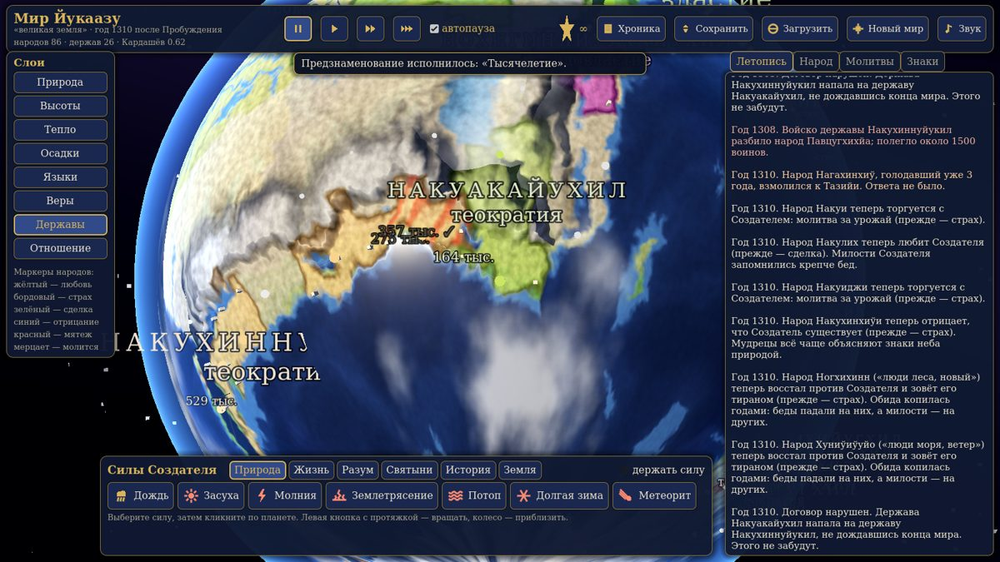
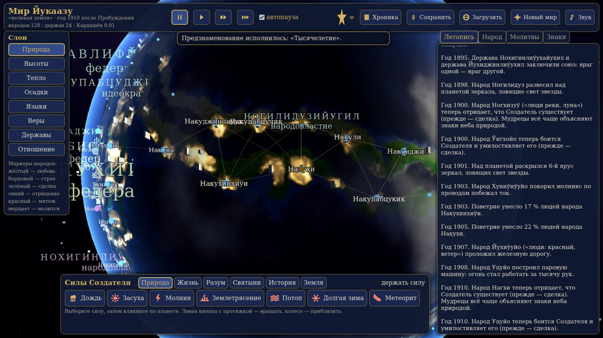
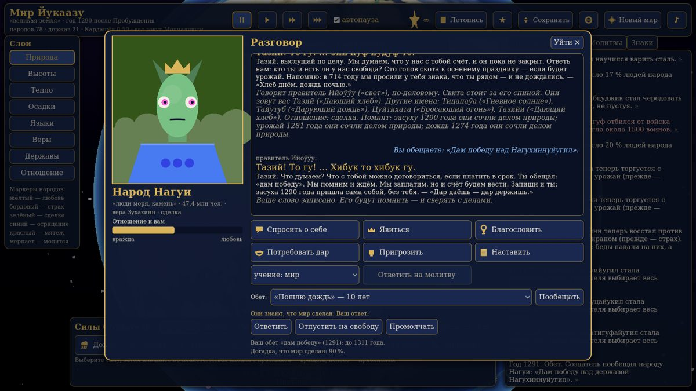
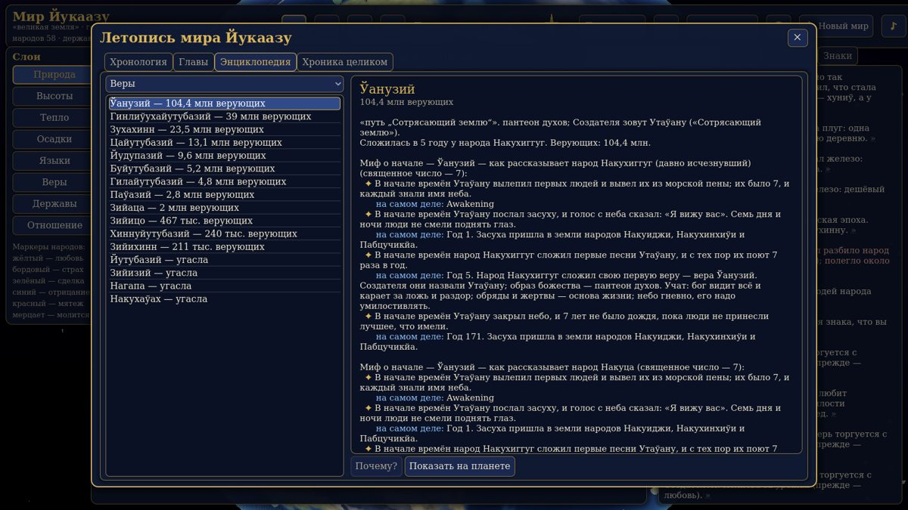

# Мироздание

Процедурный симулятор Создателя: от первой жизни на молодой планете до цивилизации первого типа по шкале Кардашёва.

Вы лепите материки, зажигаете жизнь и смотрите, как пробуждается разум. Народы сами толкуют ваши знаки: кто-то видит в молнии кару, кто-то дар, кто-то — просто погоду. Языки, веры, мифы, державы, города и войны не прописаны вручную — они вырастают из истории мира. Вмешиваться можно, но у чудес есть цена, а обещания народы помнят.



## Скачать

Сборки лежат в разделе **[Releases](../../releases)**.

| Система | Файл | Скачать | На диске |
|---|---|---|---|
| Windows 10/11, 64 бит | `mirozdanie-…-windows.zip` | ≈ 68 МБ | ≈ 170 МБ |
| Linux, x86_64 | `mirozdanie-…-linux.zip` | ≈ 60 МБ | ≈ 145 МБ |

Ставить .NET или Godot не нужно — всё внутри архива.

**Windows:** распакуйте архив и запустите `Windows\mirozdanie.exe`. Если Windows предупредит о неизвестном издателе — «Подробнее» → «Выполнить в любом случае» (сборка не подписана).

**Linux:**
```bash
unzip mirozdanie-*-linux.zip
cd Linux
./mirozdanie.x86_64
```

Не разносите файлы из папки по разным местам: игре нужны `mirozdanie.pck` и папка `data_…` рядом с исполняемым файлом.

Нужна видеокарта с поддержкой OpenGL 3.3 — подойдёт почти любая встроенная графика последних десяти лет.

## Как играть

1. **«Сотворить»** — задайте законы мира, вылепите сушу кистью, нажмите **«Зародить жизнь»**.
2. При первом мире откроется короткое обучение (F1 — показать снова).
3. **▶** — время пошло. Пробел — пауза, 1–3 — скорость.

| Действие | Как |
|---|---|
| Вращать планету / приблизить | левая кнопка мыши / колесо |
| Карточка народа | клик по народу |
| Разговор, обеты, ответ учёным | кнопка «Говорить» в карточке |
| Сила Создателя | выбрать внизу, кликнуть по планете |
| Ночь (огни городов) | N |
| Камера сама следит за событиями | C |
| Почему так вышло | значок » у строки ленты справа |
| Вся история, энциклопедия, мифы | «Летопись» сверху |
| Итог мира | ★ сверху |





## Что внутри

- Планета: тектоника, климат, реки, биомы; терраформирование кистью и 17 силами Земли.
- Жизнь: особи, отбор и видообразование до пробуждения разума.
- Языки со звуковыми законами, веры с расколами, мифы, искажённые пересказом.
- Население в реальном масштабе, 52 открытия, энергия, потепление, ядерные войны — путь к Кардашёву I.
- Державы, города, договоры, союзы и войска на марше.
- Речь народов: у каждого свой голос и память о ваших делах.
- Просьбы и обеты, стиль бога, итог мира. В поздних эпохах учёные начинают догадываться, что мир сделан.
- Вся графика, звук и музыка создаются кодом — внешних ассетов нет.

## Статус

**Альфа.** Игра запускается и играется, но баланс и интерфейс ещё будут меняться. Сохранения между версиями могут не открываться.

Известные ограничения:
- сборка для macOS пока не выпускается;
- музыка и эффекты финала проверены только синтезом и снимками без видеокарты — возможны слишком громкие или яркие места;
- сборки не подписаны, поэтому Windows может предупреждать при первом запуске.

Сообщить об ошибке или предложить идею — в разделе **[Issues](../../issues)**.

Исходный код пока закрыт. Игра сделана на Godot 4.4 и C#.
